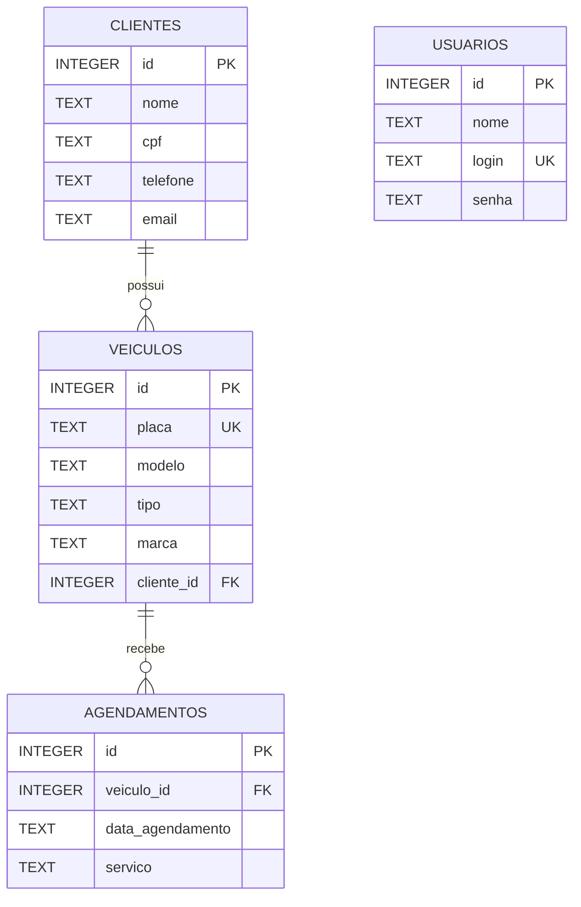

# 2. Modelo Entidade-Relacionamento (DER)

# DER — Oficina Mecânica AutoCerta

## Diagrama Entidade-Relacionamento

## Descrição das entidades

### USUARIOS
Armazena as informações de acesso dos usuários do sistema.

- `id`: chave primária.
- `nome`: nome do usuário.
- `login`: login único.
- `senha`: hash da senha armazenada com bcrypt.

### CLIENTES
Armazena os dados dos clientes da oficina.

- `id`: chave primária.
- `nome`: nome do cliente.
- `cpf`: CPF armazenado de forma criptografada.
- `telefone`: telefone de contato.
- `email`: endereço de e-mail.

### VEICULOS
Armazena os veículos cadastrados na oficina.

- `id`: chave primária.
- `placa`: placa única do veículo.
- `modelo`: modelo do veículo.
- `tipo`: tipo do veículo.
- `marca`: marca do veículo.
- `cliente_id`: chave estrangeira que referencia `CLIENTES.id`.

### AGENDAMENTOS
Armazena os serviços agendados para os veículos.

- `id`: chave primária.
- `veiculo_id`: chave estrangeira que referencia `VEICULOS.id`.
- `data_agendamento`: data do serviço no formato AAAA-MM-DD.
- `servico`: descrição do serviço.

## Relacionamentos

- **CLIENTES — VEICULOS (1:N):** um cliente pode possuir vários veículos, mas cada veículo pertence a um único cliente.
- **VEICULOS — AGENDAMENTOS (1:N):** um veículo pode ter vários agendamentos, mas cada agendamento está associado a um único veículo.
- **USUARIOS:** não possui relacionamento direto com as outras entidades no banco de dados.

## Legenda

- `PK`: chave primária.
- `FK`: chave estrangeira.
- `UK`: campo com restrição de unicidade.
- `||`: exatamente um registro.
- `o{`: zero ou vários registros.
